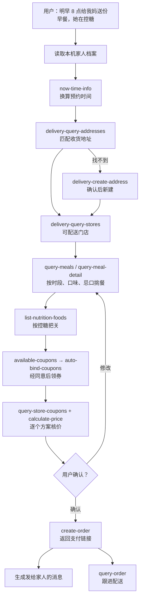

# MCP 集成说明

## 使用的 MCP Server

| 项 | 值 |
|---|---|
| 名称 | 麦当劳中国 MCP（`mcd-mcp`） |
| 地址 | `https://mcp.mcd.cn` |
| 传输 | Streamable HTTP |
| 鉴权 | `Authorization: Bearer ${MCD_MCP_TOKEN}`，Token 在 [open.mcd.cn/mcp](https://open.mcd.cn/mcp) 申请 |
| 场景 | 麦乐送外送（`beType=2`）、到店自取（`1`）、得来速（`5`）、企业团餐（`6`）、积分商城、活动预约 |

配置示例见 [`mcp-config.example.json`](mcp-config.example.json)，仓库内不含任何真实 Token。

## 使用的 Tool（35 个，全部接入）

| 流程 | Tool | 用途 |
|---|---|---|
| 通用 | `now-time-info` | 把"明早 8 点"换算成 `yyyy-MM-dd HH:mm` 格式的预约时间 |
| 外送 | `delivery-query-addresses` | 按家人档案匹配收货地址，取得 `addressId` |
| 外送 | `delivery-create-address` | 第一次给某位家人下单时，在用户账户里新建收货地址 |
| 外送、团餐 | `delivery-query-stores` | 查询地址可配送的门店，取得 `storeCode`、`beCode` |
| 到店 | `query-nearby-stores` | 按地点关键词或收藏查到店自取、得来速门店和可预约时段 |
| 挑餐 | `query-meals` | 拉取门店在预约时段的在售餐品和随单购商品 |
| 挑餐 | `query-meal-detail` | 查看套餐组成和特制选项，处理忌口、换配菜 |
| 挑餐 | `list-nutrition-foods` | 按家人的健康注意（控糖、少盐、低热量）筛选和排序 |
| 用券 | `available-coupons` | 查询麦麦省当前可领的券 |
| 用券 | `auto-bind-coupons` | 经用户同意后一键领券 |
| 用券 | `query-my-coupons` | 展示用户卡包里的券 |
| 用券 | `query-store-coupons` | 查询该门店、该时段、该取餐方式可用的券 |
| 核价 | `calculate-price` | 对每个候选方案分别核价，选实付最低的方案；返回到店取餐方式 |
| 团餐 | `query-promotions` | 查询团餐满减、满折规则，计算是否值得凑单 |
| 团餐 | `query-meal-assistance` | 查询助餐服务，取得 `gmServiceCode` |
| 下单 | `create-order` | 用户确认后创建外送、到店、得来速、团餐订单，返回支付链接 |
| 跟进 | `query-order` | 查询制作、配送状态，取得取餐码和取餐柜二维码 |
| 跟进 | `order-list` | 查询近期到店和外送订单，支持"按上次那样再点一份" |
| 跟进 | `cancel-order` | 仅在用户明确要求时取消订单 |
| 跟进 | `query-survey-coupon` | 查询订单的满意度问卷奖券 |
| 积分 | `query-my-account` | 查询可用、冻结、即将过期的积分 |
| 积分商城 | `mall-points-products` | 按类别列出可兑换的券、周边、礼品卡、活动 |
| 积分商城 | `mall-product-detail` | 查看商品规格（SKU），区分兑换商品和活动 |
| 积分商城 | `mall-create-order` | 用户确认后用积分兑换，实物寄到家人地址 |
| 积分商城 | `mall-order-list` | 查询商城兑换记录 |
| 积分商城 | `mall-order-detail` | 查询某笔兑换的积分、金额和状态 |
| 抽奖 | `query-lottery-info` | 查看积分抽奖活动、奖品和本次实际消耗 |
| 抽奖 | `draw-lottery` | 用户主动要求并确认消耗后，抽一次 |
| 抽奖 | `query-my-prizes` | 查询抽中的奖品和状态 |
| 活动 | `campaign-calendar` | 查询当月活动日历，结合家人安排给建议 |
| 活动 | `query-party-city` | 生日会、主题活动可预约的城市 |
| 活动 | `query-party-store` | 某城市可举办活动的门店 |
| 活动 | `query-party-store-date` | 某门店可预约的日期，生日会优先推荐生日附近 |
| 活动 | `query-party-store-session` | 某天的场次、余位、成团人数和价格 |
| 活动 | `party-order-create` | 用户确认后预约生日会或主题活动 |

## 调用流程

### 给家人送餐上门（主流程）

### 其他流程

| 流程 | 调用顺序 |
|---|---|
| 家人到店或得来速取餐 | `query-nearby-stores` → `query-meals` → `query-store-coupons` → `calculate-price`（取得 `takeWayCode`）→ 确认 → `create-order` → `query-order`（取餐码） |
| 给家人单位或班级点团餐 | `delivery-query-addresses` → `delivery-query-stores`（`beType=6`）→ `query-meals` → `query-promotions` → `query-meal-assistance` → `calculate-price` → 确认 → `create-order` |
| 用积分给家人换礼物 | `query-my-account` → `mall-points-products` → `mall-product-detail` → `delivery-query-addresses` → 确认 → `mall-create-order` → `mall-order-list` / `mall-order-detail` |
| 给家人预约生日会 | `mall-points-products`（`1>6>20`）→ `mall-product-detail` → `query-party-city` → `query-party-store` → `query-party-store-date` → `query-party-store-session` → 确认 → `party-order-create` |
| 积分抽奖（仅用户主动要求） | `query-lottery-info` → 展示本次消耗并确认 → `draw-lottery` → `query-my-prizes` |
| 订单跟进 | `query-order` / `order-list` / `cancel-order` / `query-survey-coupon` |

## 关键处理

- **先确认再执行**：下单、兑换、预约、抽奖、新建地址、领券、取消订单，都先展示内容和金额或积分，得到用户明确确认后才调用。不代付。
- **预约时段一致**：同一订单里的 `query-meals`、`query-meal-detail`、`query-store-coupons`、`calculate-price`、`create-order` 传同一个 `reservationDate`，保证菜单、券和价格对应送达时段。
- **核价**：价格一律以 `calculate-price` 的实时返回为准（单位为分），不使用缓存价格。
- **健康把关**：只依据 `list-nutrition-foods` 返回的数据筛选，查不到数据的餐品如实说明，不给医疗建议。
- **抽奖克制**：只在用户主动要求时进行，以 `drawDecision` 判断能否抽和实际消耗，不连抽、不试抽。
- **隐私**：家人的手机号和详细地址只存在用户自己的麦当劳账户里。本机档案（`~/.mcd-feed/people.json`）只记称呼、联系人姓名、小区名、口味、忌口、健康注意、生日和常去门店；展示手机号时打码。
- **备注区分**：`remark` 给门店和骑手看；想对家人说的话，生成为一条单独的消息由用户转发。

## 业务价值

人在外地，想照顾家里人，在麦当劳 App 里要切收货地址、核对送达时段的菜单、挑券、写备注，下完单还要另外告诉家人；给家人换积分礼物、订生日会，也要在 App 里一层层找。本技能把这些事都合成一句话：记住家里每个人的地址、口味和健康情况，按预约时间挑出合适又最省的方案，确认后下单、兑换或预约，并写好通知家人的消息。
