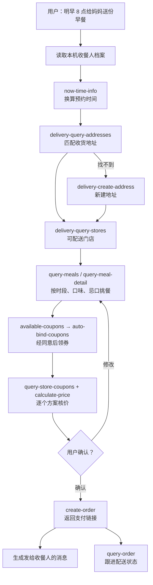

# MCP 集成说明

## 使用的 MCP Server

| 项 | 值 |
|---|---|
| 名称 | 麦当劳中国 MCP（`mcd-mcp`） |
| 地址 | `https://mcp.mcd.cn` |
| 传输 | Streamable HTTP |
| 鉴权 | `Authorization: Bearer ${MCD_MCP_TOKEN}`，Token 在 [open.mcd.cn/mcp](https://open.mcd.cn/mcp) 申请 |
| 场景 | 麦乐送外送：`beType=2`、`orderType=2` |

配置示例见 [`mcp-config.example.json`](mcp-config.example.json)，仓库内不含任何真实 Token。

## 使用的 Tool

| Tool | 所在步骤 | 用途 |
|---|---|---|
| `now-time-info` | 确定时间 | 把"明早 8 点"换算成 `yyyy-MM-dd HH:mm` 格式的预约时间 |
| `delivery-query-addresses` | 找地址 | 按收餐人档案里的联系人匹配收货地址，取得 `addressId` |
| `delivery-create-address` | 找地址 | 第一次给某位家人下单时，在用户账户里新建收货地址 |
| `delivery-query-stores` | 找门店 | 查询该地址可配送的门店，取得 `storeCode` 和 `beCode` |
| `query-meals` | 挑餐 | 拉取该门店在预约时段的在售餐品（早餐时段只返回早餐） |
| `query-meal-detail` | 挑餐 | 查看套餐组成和特制选项，用于处理忌口（如"不要洋葱"） |
| `available-coupons` | 用券 | 查询麦麦省当前可领的券 |
| `auto-bind-coupons` | 用券 | 经用户同意后一键领券 |
| `query-store-coupons` | 用券 | 查询该门店、该时段可用于外送的券 |
| `calculate-price` | 用券 | 对每个候选方案分别核价，选出实付最低的方案 |
| `create-order` | 下单 | 用户确认后创建预约外送订单，返回支付链接 |
| `query-order` | 跟进 | 查询制作和配送状态 |
| `cancel-order` | 跟进 | 仅在用户明确要求时取消订单 |

## 调用流程

## 关键处理

- **预约时段一致**：预约下单时，`query-meals`、`query-meal-detail`、`query-store-coupons`、`calculate-price`、`create-order` 传同一个 `reservationDate`，保证菜单、券和价格都对应送达时段。
- **核价**：所有价格来自 `calculate-price` 的实时返回（单位为分），不使用缓存价格。
- **下单门槛**：`create-order` 前必须展示确认卡并得到用户明确确认；不代付、不主动取消。
- **隐私**：收餐人的手机号和详细地址只存在用户自己的麦当劳账户里。本机档案（`~/.mcd-feed/people.json`）只记称呼、联系人姓名、小区名、口味和忌口；界面展示手机号时打码。
- **备注区分**：`remark`（最多 50 字）给门店和骑手看；用户想对收餐人说的话，生成为一条单独的消息由用户转发。

## 业务价值

人在外地，想给家里点一份外卖，在麦当劳 App 里要切收货地址、确认送达时段的菜单、挑券、写备注，下完单还要另外告诉家人。本技能把这些步骤合成一句话：记住家里每个人的地址和口味，按预约时间挑出该时段在售、用券后最便宜的方案，确认后下单，并写好通知家人的消息。
